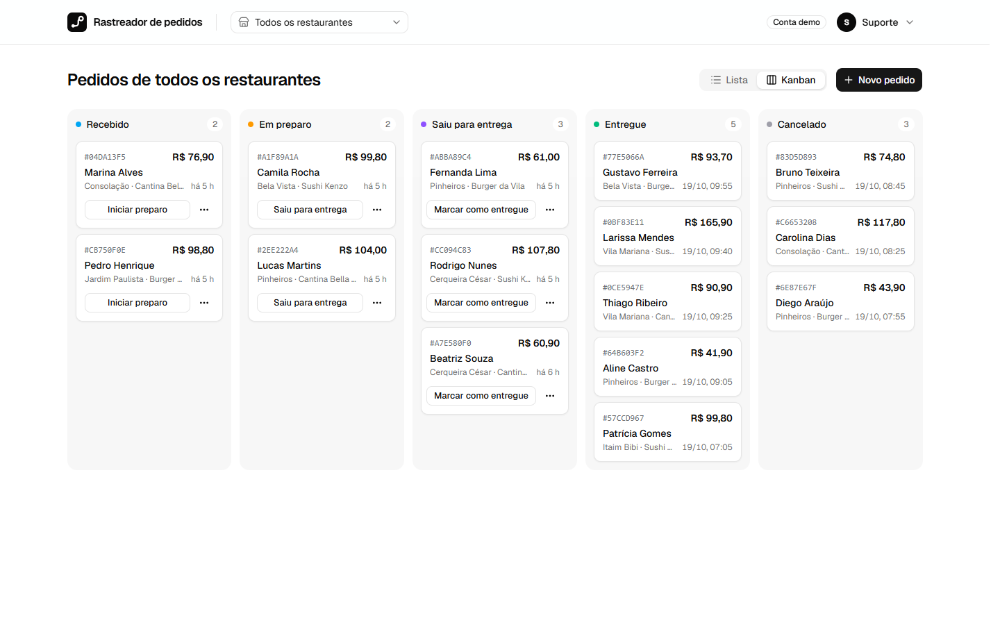
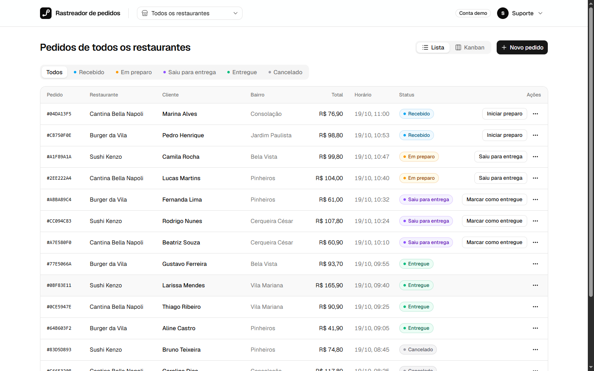
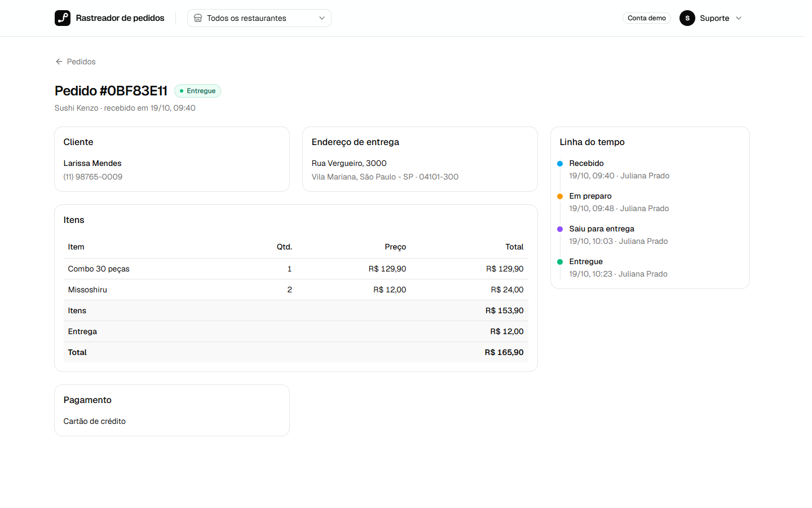
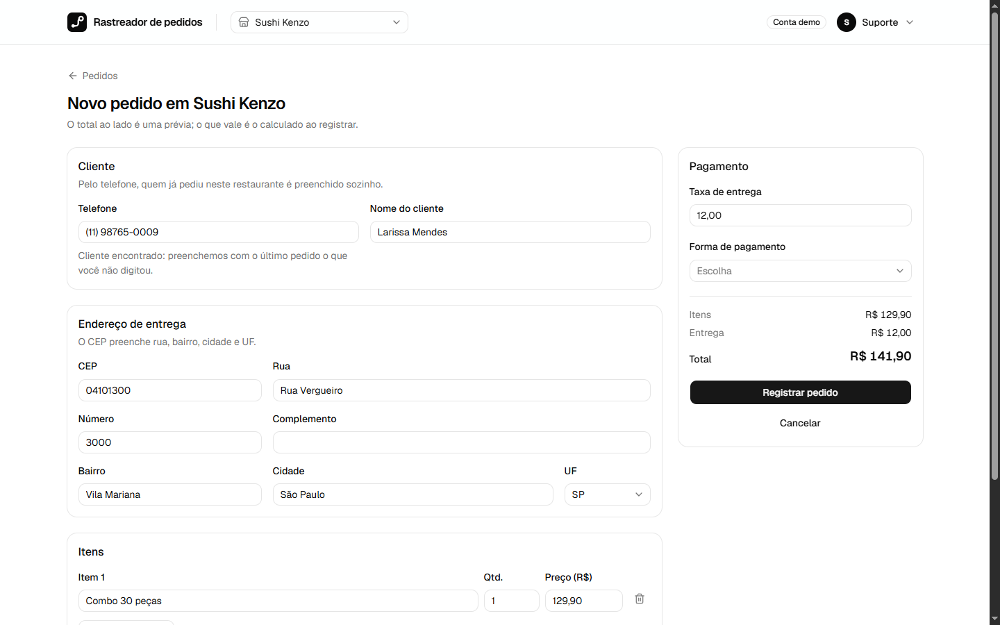
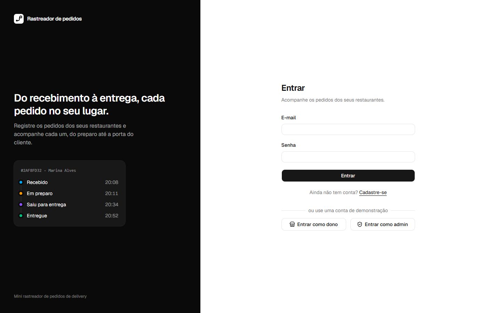
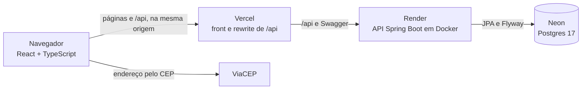
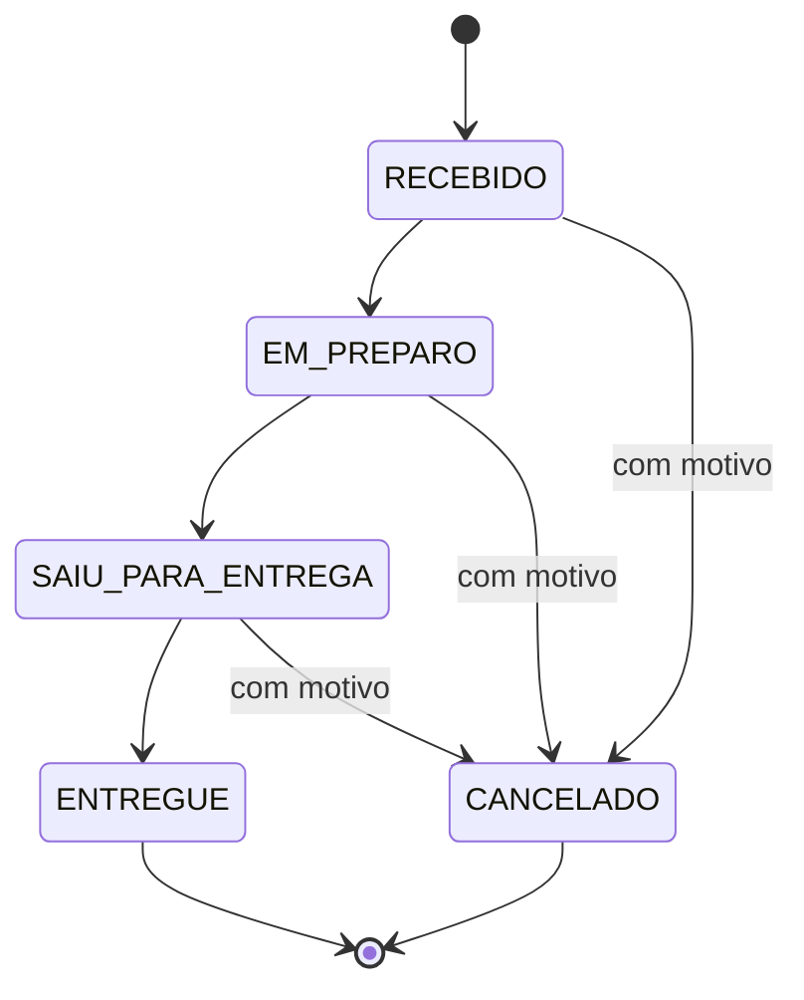
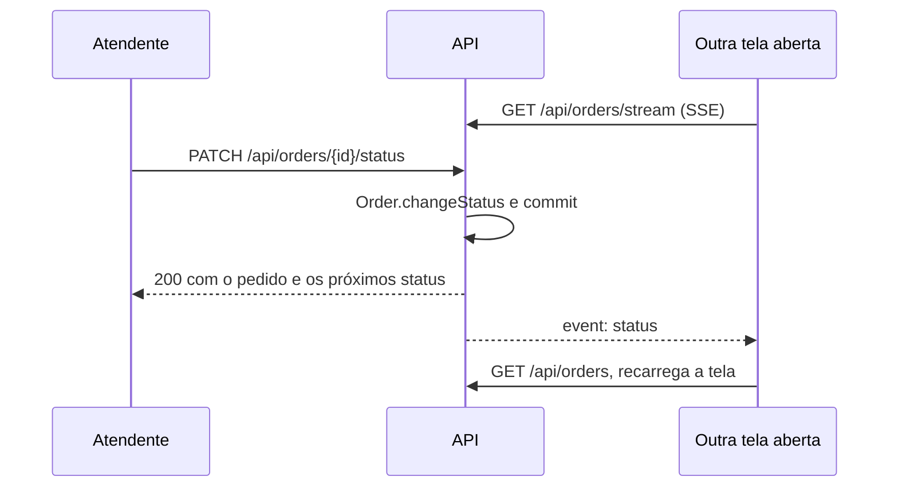

# Rastreador de pedidos

[](https://github.com/guilhermedkdk/order-tracker/actions/workflows/ci.yml)

Mini rastreador de pedidos de delivery, feito para um desafio técnico. Restaurantes registram pedidos
e acompanham cada um do recebimento à entrega. API em Java 25 com Spring Boot 4.1, front em React com
TypeScript e banco Postgres.



## Demo

**https://order-tracker-iota-ruddy.vercel.app**

Na tela de login, use "Entrar como dono" ou "Entrar como admin". A documentação da API fica em
[/swagger-ui.html](https://order-tracker-iota-ruddy.vercel.app/swagger-ui.html). A API roda no plano
gratuito do Render e dorme depois de uns 15 minutos sem acesso, então o primeiro acesso depois disso
pode levar um ou dois minutos.

| Lista com filtro por status | Detalhe com a linha do tempo |
| --------------------------- | ---------------------------- |
|  |  |
| **Novo pedido, preenchido pelo telefone** | **Entrar, com as contas de demonstração** |
|  |  |

## O que tem

- **Cadastro, login e sessão.** Um JWT de 15 minutos e um refresh token de 7 dias, os dois em cookies
  httpOnly que o JavaScript da página não lê, com proteção CSRF. Cada renovação troca o refresh token,
  e um token trocado que reaparece encerra a sessão. Toda rota fora do cadastro, do login, da
  renovação e da documentação exige sessão.
- **Restaurantes e papéis.** Quem se cadastra é dono e vê só os próprios restaurantes. O admin vê
  todos. Um seletor no topo troca o restaurante, e a escolha fica na URL.
- **Pedidos.** Cliente, endereço de entrega, itens, taxa, forma de pagamento com troco e observações.
  A API calcula o total e valida cada campo, com mensagens em português apontando o campo certo.
- **Status com regras.** `RECEBIDO → EM_PREPARO → SAIU_PARA_ENTREGA → ENTREGUE`, um passo por vez, e
  `CANCELADO` a partir de qualquer status em andamento, sempre com motivo. Transição inválida responde
  409. Cada mudança entra no histórico com autor e horário.
- **Lista e busca.** Pedidos do mais novo para o mais antigo, com filtro por restaurante e status,
  paginação e busca por id. Pedido de outro restaurante responde 404, como se não existisse.
- **Detalhe e kanban.** Cada pedido tem uma página com itens, pagamento e a linha do tempo do status.
  Além da lista, um kanban com uma coluna por status, em que o pedido avança arrastando o card.
- **Tempo real.** Lista, kanban e detalhe se atualizam sozinhos quando outra pessoa muda um pedido, por
  SSE, e cada um recebe só os pedidos que enxerga.
- **Preenchimento automático.** O telefone traz o nome e o último endereço de quem já pediu no
  restaurante, e o CEP preenche rua, bairro, cidade e UF pelo ViaCEP, sem apagar o que foi digitado.
- **Demonstração.** Contas prontas com três restaurantes e 15 pedidos em todos os status, login de um
  clique e um botão para o admin restaurar os dados de exemplo.
- **Documentação da API** no Swagger, em português, com login e CSRF funcionando pela própria página.
- **Docker e CI.** `docker compose up` sobe o sistema inteiro, e o GitHub Actions roda os testes e o
  build das imagens a cada push.

## Arquitetura

O navegador só fala com o domínio da Vercel. Ela serve o front e repassa `/api` para a API no Render,
então os cookies de sessão são do mesmo site. A única chamada para fora é a do ViaCEP.



As transições de status existem num lugar só, o agregado `Order`. O front mostra apenas as ações que
cada pedido traz em `allowedNextStatuses`.



Uma mudança de status chega às outras telas depois do commit, e só a quem enxerga aquele restaurante:



## Como rodar

Precisa de Java 25 ([Temurin](https://adoptium.net)), Node 24 com pnpm 10 e o Docker aberto. Não
precisa instalar Maven nem Postgres: o Maven Wrapper vem no repositório, e o Spring Boot sobe o
Postgres sozinho pelo Docker Compose.

API, de dentro de `backend/` (no PowerShell, `.\mvnw spring-boot:run`):

```bash
./mvnw spring-boot:run
```

Ela responde em http://127.0.0.1:8080, e o Swagger fica em http://127.0.0.1:8080/swagger-ui.html.

Front, de dentro de `frontend/`:

```bash
pnpm install
```

```bash
pnpm dev
```

Abra http://localhost:5173. O Vite repassa `/api` para a API, então o navegador fala com uma origem
só.

### Só com Docker

Sem Java nem Node instalados, da raiz do repositório:

```bash
docker compose up --build
```

O app fica em http://localhost:8081 e o Swagger em http://localhost:8081/swagger-ui.html. O nginx
serve o front e repassa `/api` para a API, como a Vercel faz em produção. A primeira subida demora
alguns minutos, porque compila a API e o front dentro dos containers.

### Contas de demonstração

Todas com a senha `demo1234`. A tela de login também tem os botões "Entrar como dono" e "Entrar como
admin".

| Conta | Papel | Restaurantes |
| ----- | ----- | ------------ |
| `admin@example.com` | Admin | Vê todos e pode restaurar a demonstração |
| `rafael@example.com` | Dono | Cantina Bella Napoli e Burger da Vila |
| `juliana@example.com` | Dona | Sushi Kenzo |

## Testes

Backend, de dentro de `backend/`: formatação (Spotless) e testes. Os testes HTTP rodam contra um
Postgres de verdade, que o Testcontainers sobe no Docker, com cookie e CSRF reais.

```bash
./mvnw verify
```

Front, de dentro de `frontend/`: tipos, lint (oxlint), formatação (Prettier) e testes (Vitest com
Testing Library e MSW).

```bash
pnpm check
```

## Como está organizado

```
backend/    API Spring Boot, organizada por funcionalidade
  auth/          cadastro, login, sessão com refresh token, CSRF e o usuário da requisição
  restaurant/    restaurantes e a regra de quem enxerga o quê (RestaurantScope)
  order/         o agregado Order, com totais, status e histórico, e a API de pedidos
  customer/      a base de clientes de cada restaurante, que preenche o próximo pedido
  live/          o stream SSE das mudanças de status
  demo/          contas e pedidos de demonstração
  shared/        formato dos erros (Problem Details), paginação e documentação
frontend/   React + Vite, organizado por funcionalidade em src/features/
docs/       especificação, arquitetura, glossário e decisões
```

Os documentos em `docs/` contam o porquê de cada parte:

- [SPEC.md](docs/SPEC.md): o que o sistema faz, com o checklist dos requisitos do desafio e o teste
  que prova cada um.
- [ARCHITECTURE.md](docs/ARCHITECTURE.md): onde cada parte roda, os pacotes e como são testados.
- [GLOSSARY.md](docs/GLOSSARY.md): o vocabulário do domínio.
- [DECISIONS.md](docs/DECISIONS.md): as escolhas que não são óbvias e as armadilhas encontradas.

## Decisões que valem destacar

- **Postgres, não SQLite.** O desafio aceita "SQLite ou similar". Com Postgres em todo lugar, o que os
  testes conferem é exatamente o que roda em produção.
- **Regras de status só no backend.** Cada pedido vem com `allowedNextStatuses`, e o front mostra só
  essas ações. A tabela de transições existe num lugar só.
- **Pedido guarda a própria cópia do cliente e do endereço**, para o histórico não mudar quando um
  cadastro muda.
- **Um único lugar decide visibilidade.** `RestaurantScope` responde quais restaurantes cada usuário
  enxerga, e todo o resto, inclusive o stream em tempo real, pergunta a ele.
- **Sessão em cookie, não no `localStorage`.** Um XSS não lê o token, e a API fica no mesmo site pelo
  rewrite da Vercel, porque navegadores bloqueiam cookie de terceiros.
- **Dados de demonstração passam pelo domínio.** Os pedidos de exemplo são criados pelas mesmas regras
  de um pedido de verdade, então não ficam inconsistentes quando uma regra muda.

## Como foi construído

Em três fases, cada uma numa branch com um PR revisado antes do merge commit, que preserva os commits
de cada passo no histórico:

1. **O obrigatório do enunciado** ([PR #1](https://github.com/guilhermedkdk/order-tracker/pull/1)):
   autenticação, restaurantes, pedidos com regras de status, telas, demonstração e Swagger.
2. **Polimento e deploy** ([PR #2](https://github.com/guilhermedkdk/order-tracker/pull/2), depois
   [#3](https://github.com/guilhermedkdk/order-tracker/pull/3) a
   [#5](https://github.com/guilhermedkdk/order-tracker/pull/5) no deploy): detalhe, filtro e
   paginação, base de clientes, CEP, kanban, Docker Compose, CI e a demo no ar.
3. **Extras** ([PR #6](https://github.com/guilhermedkdk/order-tracker/pull/6)): refresh token com
   rotação, tempo real por SSE e este README.

## Como usei IA

Construí o projeto em par com o Claude Code, um agente de IA que trabalha no terminal. Eu decidi o
que construir e revisei cada passo; o agente escreveu a maior parte do código, dos testes e dos
documentos. O que fez a diferença foi o processo em volta:

- **Uma entrevista antes do código.** O agente me fez perguntas sobre cada ponto aberto do enunciado
  (papéis, sessão, banco, o que entra em cada fase) até as decisões ficarem claras. As respostas
  viraram o [SPEC](docs/SPEC.md), o [glossário](docs/GLOSSARY.md), a
  [arquitetura](docs/ARCHITECTURE.md) e as primeiras [decisões](docs/DECISIONS.md).
- **Regras que valem em toda sessão.** O [CLAUDE.md](CLAUDE.md) guarda o que nenhuma mudança quebra,
  como "as transições vivem só em `Order`" e "visibilidade sai só do `RestaurantScope`", e o agente o
  lê antes de qualquer tarefa.
- **Teste antes da implementação.** Cada regra começou por um teste que falhava. Quando um teste veio
  depois do código, o agente quebrou o código de propósito para provar que o teste pegava a falha.
- **Revisão antes de cada merge de fase.** Um segundo agente revisou o PR de cada fase procurando bugs:
  foram 10 achados na fase 1 e 15 na fase 2, cada um corrigido com um teste de regressão antes do
  merge.
- **Conferência fora dos testes.** As telas foram abertas no navegador, e a demo publicada foi
  percorrida pela Vercel. Isso achou três problemas que os testes não viam: o Swagger sem a definição
  da API, o "Try it out" chamando o Render direto e o login sem token CSRF enquanto a API acordava.
- **O que ficou comigo.** As decisões de produto e de escopo, as contas no Neon, no Render e na Vercel
  (nenhuma senha passou pelo agente), a aprovação de cada merge e a revisão do histórico.

A IA também errou, e o processo pegou: o arrasto do kanban disparava de dentro do diálogo de
cancelamento, corrigir o telefone no novo pedido mantinha os dados do cliente anterior, e a estimativa
do tempo de partida da API no Render estava otimista. As armadilhas desse tipo ficaram registradas no
[DECISIONS.md](docs/DECISIONS.md).

## Fora do escopo

De propósito, para não abrir regras que ninguém pediu: edição de pedido depois de criado, exclusão de
restaurante, funcionários por restaurante, vários endereços por cliente, cardápio, limite de
tentativas de login, confirmação de e-mail e recuperação de senha. O tempo real guarda as conexões na
memória da API, então vale para uma instância só.
